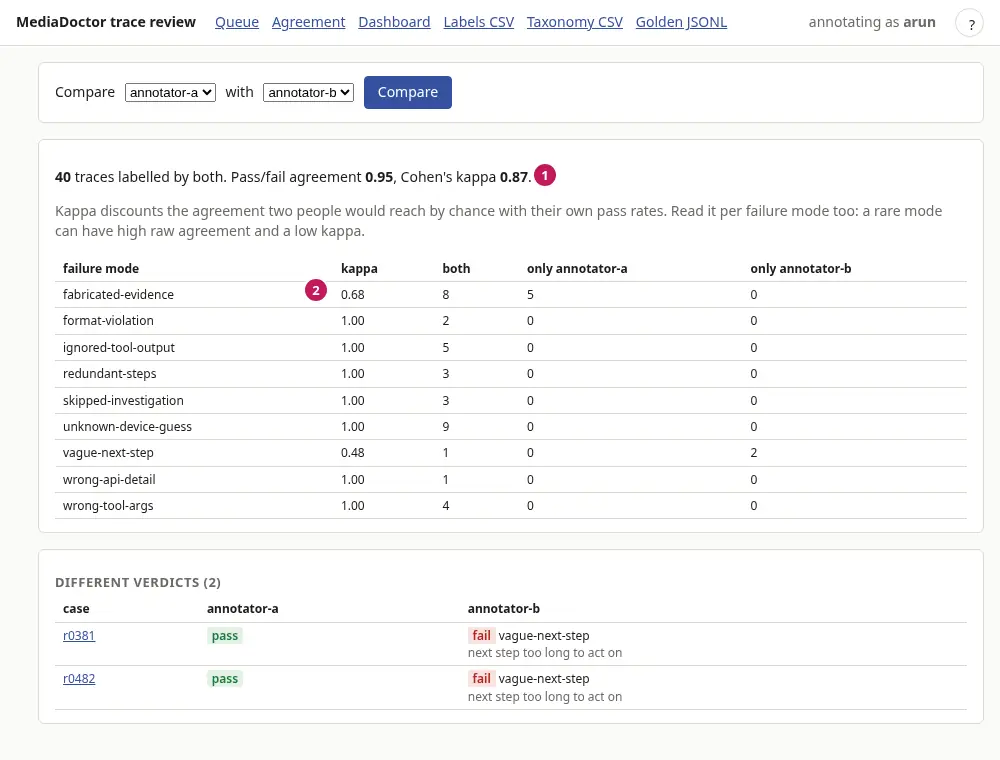

# 9. Production monitoring and a custom annotation app

**Goal:** keep measuring after release, notice when the traffic or the agent changes, and turn what you find in
production into labelled cases for the next round.

**Estimated time:** 8 hours (lesson 2 h, lab 4 h, exercises and quiz 2 h)

By the end of this module you will be able to:

- say what an online eval can and cannot do that an offline one can, and which evaluators belong where;
- sample production traces at random, by stratum, and by signal (thumbs-down, retries, slow responses, tool errors,
  failed checks), and still estimate a pass rate correctly from a biased queue;
- run cheap code checks on every request and an LLM judge on a sample, and correct the judge's rate for its known
  errors;
- detect drift in the inputs (topics, devices), in the outputs and metrics (p-charts and CUSUM), and around model
  snapshot changes, and tell the three apart;
- read explicit and implicit user feedback for what it is: sparse, biased, and still useful as a pointer;
- review traces in a keyboard-driven annotation app built for this agent, measure agreement between two annotators
  with Cohen's kappa, and promote reviewed traces into golden-dataset candidates.

Artifacts: the annotation app (`labs/annotate`, `uv run annotate serve`), the monitoring dashboard (the app's
`/dashboard` page and `uv run mediadoctor-lab09 monitor`), labels v2 (`data/labels/production_modes_v2.toml`, with the
new `unknown-device-guess` mode), the new `evalkit.monitor` module and `evalkit.annotate.kappa_report`, the lab CLI
(`uv run mediadoctor-lab09`), and the [monitoring cheat sheet](../../cheatsheets/monitoring.md).

## Intuition: a field-trial dashboard and a bug-triage tool you wrote yourself

When a player or a codec ships to millions of devices, the lab results stop being the whole story. You watch field
telemetry: crash rates by build, decoder fallbacks by SoC, rebuffering by network type. You do not read every
session; you sample, and you pay extra attention to sessions that crashed, retried, or took too long. When a new
phone shows up in the device mix, you notice before anyone files a bug, because the dashboard is split by device.
And when someone does file a bug, the triage tool that helps most is rarely the generic one. It is the internal page
that shows the `ffprobe` output, the decoder that was picked, and the logcat lines around the stall on one screen.

Production evals are the same job. Offline evals (modules 5 to 8) answer "is this version good on the cases we
chose?". Production asks two other questions: "are the cases we chose still the cases users bring?" and "did
something change that our cases cannot see?". You answer them with cheap checks on everything, judges on a sample,
drift charts, and a queue of traces that people read. Reading is still the core activity, so the reading tool matters:
generic trace viewers show generic spans, while a small app that renders this agent's probe output, decoder lists,
and logcat next to the answer turns a two-minute review into a fifteen-second one. This module builds that app.

## Step 1: online and offline evals

| | Offline (modules 5 to 8) | Online (this module) |
|---|---|---|
| Inputs | a fixed golden set you chose | whatever users send, today |
| Labels | reviewed in advance | none at first; you sample and label |
| When | before a change ships, in CI | continuously, after it ships |
| Good at | comparing versions on the same cases; gating | noticing new inputs, new failures, and changes you did not make |
| Blind to | inputs you did not think of | anything you do not sample or log |

Both use the same evaluators, at different volumes. A rule of thumb that the lab follows:

- **Code checks on all traffic.** They are free, deterministic, and fast: format, citations that point at real
  evidence (module 5's `check_evidence_is_real`), and "investigated before answering". Every request gets them.
- **Judges on a sample.** A judge call costs money and time, and its verdict has known errors (module 5). Run it on a
  random fraction, and report its rate with the judge-error correction from module 6.
- **People on a smaller, targeted sample.** The annotation queue. Human labels are the only ones that can find a
  failure mode nobody has named yet.

**Online experiments.** When a change is safe to expose to some users, an A/B test answers what offline evals
cannot: what real users do with it. Randomise by user, not by request (so one person does not see both versions),
decide the primary metric and the guardrails before starting, use the paired and multiple-comparison discipline of
module 6, and do not stop early because a daily p-value looked good (module 6, "Looking more than once"). Kohavi,
Tang, and Xu's [Trustworthy Online Controlled Experiments](https://experimentguide.com/) is the reference. The
offline gate (module 8) still runs first: an online test is for changes that passed it, not a replacement.

Things you did not change also change in production: the provider updates a model snapshot, an app release changes
what users ask, a new phone appears. Online evals are how you find out. Hamel Husain and Shreya Shankar's FAQ answer on
[how evaluations differ between CI and production](https://hamel.dev/blog/posts/evals-faq/how-are-evaluations-used-differently-in-cicd-vs-monitoring-production.html)
makes the same split.

## Step 2: the simulated week

The lab replays one week of MediaDoctor traffic: Monday 16 to Sunday 22 November 2026 (IST), 766 requests from 176
users. Each request replays a recorded trace (module 3's 100 traces of the released prompt, plus 40 new AV1 traces
recorded for this module) with its own request id, time, user, app version, model snapshot, latency, and feedback.
Two events are planted, and the lab's job is to find them from the data:

| When (IST) | Event | What it does |
|---|---|---|
| Tue 17, 14:00 | the provider's serving stack changes under the same model id (recorded as `claude-sonnet-5-5-20261001` to `-20261116`, fictional build labels) | nothing, by construction |
| Thu 19, 10:00 | app 4.2 starts a staged rollout (15%, then 40%, 70%, and 90% of users) that makes AV1 the default codec | about three quarters of 4.2 requests ask about AV1, and 90 of the 252 about a new phone, the `vela-v2`, which has no device profile |

!!! info "Synthetic traffic, generated by Claude subagents"
    The week's traffic and feedback are generated by `scripts/author_module09_fixtures.py` from documented rules, and
    the 40 AV1 cases are labelled `"source": "synthetic-authored"`. The agent's turns in those traces were generated by
    Claude subagents, and the reference labels and the two annotators' labels by Claude Opus annotators. Module 3's
    traces are replayed many times each, so "766 requests" is really 140 distinct traces in different contexts.
    Everything the lab reports (the charts, alarms, queues, estimates, and agreement) is computed from those files.

The regenerated agent fails rarely. Only 4 of the 140 distinct traces fail, all with `fabricated-evidence` (a correct
answer that adds a detail no tool returned), which makes 25 failing requests in the week (3.3%). The two events are
still in the data, and the monitoring finds them; what this week shows is that a drift alarm and a quality problem are
not the same thing. Where a section's point needs more failures than this week has, it says what the data shows now
and what the method would show on a worse week.

Because every request carries a known label, the lab can show the truth next to each estimate. In production you
would not have that column; that is the point of the rest of the module.

## Step 3: sampling production traces

You cannot read 766 traces a week, let alone 766,000. Four ways to choose, all in `evalkit.monitor`:

- **Random.** Each request with probability `rate`, decided by a hash of its id (`stable_fraction`), so the same
  request is always in or out and the sample is reproducible. Random is the only sample whose failure rate estimates
  the population's, and the only one that can surface a failure nothing flags.
- **Stratified.** A few requests from every stratum (here, every topic), so rare topics are not drowned out by
  common ones.
- **Signal-triggered.** Every request with a signal: a failed code check, a thumbs-down, a tool error, a retry (the
  same user asking the same thing within ten minutes), or a slow response (above the reference window's p95,
  22,582 ms). These find failures fast, but only the kinds that set off a signal.
- **Judge-triggered.** Judge-failed requests, or (exercise 1) requests where the judge and the other evidence
  disagree.

The FAQ answer on [sampling production traces](https://hamel.dev/blog/posts/evals-faq/how-can-i-efficiently-sample-production-traces-for-review.html)
orders these from exploratory to targeted and recommends keeping some random traces in every batch; the lab's queue
does exactly that. `lab09.queue()` builds it in four moves:

1. take every signalled request (probability 1), a 5% random sample, and 3 requests per topic;
2. fold identical traces together (same fingerprint: same question, tool calls, and answer), keeping a count;
3. order triggered items by signal (failed check first, then thumbs-down, tool error, retry, slow);
4. interleave: two triggered items, then one random or stratified item, so a reviewer never reads a long run of
   failures and starts expecting them.

**A biased queue gives a biased rate.** The queue exists to find failures, so it over-represents them. Read naively,
it says the week fails 5.8% of the time. The truth is 3.3%. Each item was picked with a known probability, so weight
each label by one over that probability (the Horvitz-Thompson idea, in its ratio form, the Hajek estimator:
`evalkit.monitor.weighted_rate`):

| Estimate of the week's failure rate | Value |
|---|---|
| truth (simulation only) | 0.033 |
| the queue, unweighted (207 picks) | 0.058 |
| the queue, weighted by 1/p | 0.040 |
| the random part only (29 picks) | 0.069 |

The weighted queue uses every label and lands closer to the truth; the random part alone is unbiased but noisy at
n=29 (two failures; Wilson 95% interval [0.019, 0.220]). The weighted estimate needs an interval too, and the Wilson
formula does not apply to it: resample the queue's picks with replacement, recompute the weighted rate each time, and
take the middle 95% (`evalkit.monitor.weighted_rate_ci`). Here it is **0.040 [0.010, 0.096]**: narrower than the
random part alone, because the triggered picks carry information, but still wide, because the week's 25 failing
requests come from only 4 distinct traces. On a week with more failures the unweighted queue is further off (the
signals find more of them) and the weights matter more. Never report a pass rate from a triggered queue without
weights, and never without its interval.

## Step 4: code checks on everything, a judge on a sample

The code checks run on all 766 requests and cost nothing. The online judge is module 5's tool-grounding judge (v2),
run on a 30% random sample (230 requests; it applies to 227 of them, where a tool succeeded). Module 6's bootstrap
corrects its rate with the TPR and TNR measured on module 5's test split, but that split now has 28 labelled traces
and every one of them passes: the judge's TPR is 1.00 and its TNR cannot be measured.

| Period | n | Judge's pass rate | Corrected [95% CI] | Truth (simulation only) |
|---|---|---|---|---|
| before the rollout | 133 | 1.000 | not defined | 1.000 |
| after the rollout | 94 | 1.000 | not defined | 1.000 |

Three lessons sit in this table.

- **A judge only sees its own criterion.** The judge checks for `ignored-tool-output`, and no trace this week has
  that mode, so its rate stays at 1.000 across the rollout, and the truth agrees. The week's real failures
  (`fabricated-evidence`) and its real change (tool errors on the `vela-v2`) are both outside what it was asked.
  When the judge's rate does move, use the raw rate for change detection: the same judge on both sides of a change
  is a fair comparison even when its errors are not known exactly. It is not a measurement of how much the agent
  changed until the judge is re-validated.
- **The correction needs failing labels.** With no failing trace in the validation set, the TNR is undefined, so
  there is no corrected rate and no interval (the bootstrap cannot run). A pass rate of 1.000 from a judge that
  has never been shown a failure is equally consistent with a perfect agent and with a judge that passes
  everything. Before quoting a corrected level, label failing traces for the judge's criterion (the queue is a
  good place to look for them); module 6's advice on validation size applies here with force.
- **The judge's errors can drift too.** On the 40 new AV1 traces it applies to 39, all passing, and passes all 39
  (TPR 1.00); with no failing AV1 trace, its TNR on the new traffic is unknown as well. New traffic is exactly where
  a judge's validation is least relevant: re-validate on a labelled sample of the new traffic.

## Step 5: drift

"Drift" covers three different things, and the response differs:

| Drift | What moved | How the lab sees it | Typical response |
|---|---|---|---|
| Input | what users ask | topic shares by day, PSI against the reference window; new device names | add cases to the golden set; check coverage |
| Output and metric | what the agent does | p-chart and CUSUM on the code checks' failure rates; judge rate | read the traces behind the change |
| System | the model, prompt, or tools | the model snapshot attribute on every trace; before/after comparison | treat it as a release you did not make |

**Input drift.** A small rule-based tagger (`tag_topic`, `tag_device`) puts each question into one of the golden
set's topics and extracts the device name. Topic shares against Monday to Wednesday give a population stability
index (PSI; above 0.1 is "worth a look", above 0.25 is a real shift):

| Day | Requests | AV1 share | Topic PSI | New devices | App 4.2 share |
|---|---|---|---|---|---|
| Mon 16 | 120 | 20.0% | 0.026 | | 0% |
| Tue 17 | 125 | 24.8% | 0.043 | | 0% |
| Wed 18 | 124 | 16.9% | 0.036 | | 0% |
| Thu 19 | 131 | 29.0% | 0.141 | vela-v2 | 18% |
| Fri 20 | 125 | 68.8% | 1.049 | vela-v2 | 80% |
| Sat 21 | 75 | 74.7% | 1.629 | vela-v2 | 91% |
| Sun 22 | 66 | 74.2% | 1.992 | vela-v2 | 92% |

A tagger is a classifier with its own errors. The lab's rules score 1.000 on the week's own questions (they were
written while looking at them) and 0.845 on module 4's 200 questions they never saw. Validate a tagger on held-out
questions, like any other evaluator, before trusting a PSI built on it.

**Metric drift: control charts.** A p-chart (the NIST handbook's
[attribute control charts](https://www.itl.nist.gov/div898/handbook/pmc/section3/pmc332.htm)) plots each day's
failure rate against limits of three standard errors around the reference rate, so a small day gets wider limits.
The `format_fail` check has a reference rate of 1.4%, and every day of the week stays inside its limits. The CLI's
chart is for `evidence_fail` (an answer cites a tool that did not run), and that check never fails this week, so its
reference rate is 0 and its limits collapse to [0, 0]: a p-chart on a metric with no reference failures becomes
"alarm on the first failure". The same happens to `tool_error` (`lab09.chart("tool_error")`): none from Monday to
Wednesday, then 6.9% on Thursday and 29 to 33% on each later day, every one of them above the limit. A zero
reference rate is worth a floor, or a longer reference window, before you put a chart on a pager.

Daily charts are slow: they wait for a day to end. **CUSUM** (cumulative sum; E. S. Page, 1954) accumulates evidence
request by request. For a 0/1 stream with reference rate p0, each request adds the log-likelihood ratio of "the rate
is now p1" against "it is still p0", the sum never goes below zero, and the alarm fires when it crosses h. With
p1 = 2·p0 and h = 4 (the lab floors p0 at 0.5%, since a zero rate cannot be doubled):

| Metric | Reference rate | p0 | Alarm (IST) | After the rollout |
|---|---|---|---|---|
| tool_error | 0.0% | 0.5% | Thu 19, 18:36 | +8.6 h |
| evidence_fail | 0.0% | 0.5% | none | |
| thumbs_down | 1.6% | 1.6% | none | |
| format_fail | 1.4% | 1.4% | none | |

Choosing h is a trade between false alarms and delay; exercise 2 measures both on replayed traffic. The thumbs-down
rate never alarms: Step 6 explains why. And an alarm is a reason to read traces, not a verdict: the tool errors are
`codec_caps` failing for the `vela-v2`, and the reference labels pass every answer behind them (Step 6).

**System drift: model snapshots.** Every trace records `gen_ai.response.model`. The simulation gives it fictional
dated values so a change is visible in the data; current Claude model ids carry no date suffix, and the id you pin
is the id you get back, so in practice a change shows up as a new model id you chose to adopt, a provider notice, or
a step in your own metrics with no release of yours behind it. Whatever the source, compare the 24 hours on each
side: `evidence_fail` went from 0/123 to 0/115 (p = 1.00). Zero on both sides is not proof of no change: with 0
failures in 115 requests, the 95% upper bound on the new rate is still about 3/115, or 2.6% (the "rule of three").
Here there was none (the simulation makes the snapshot change harmless), but you cannot know that from 238 requests.
Treat a snapshot change like a release you did not make: re-run the offline gate from module 8 against the new
snapshot, where the paired comparison has the power that a before/after comparison of different traffic lacks.

**Discovering what you did not name.** A rule-based tagger can only find the topics it has rules for; the
`vela-v2` shows up because the device extractor reports any name it does not know. For questions no rule anticipates,
cluster the traffic: embed each question (or have a model write a one-line summary of it first, which also strips
personal details), cluster the embeddings, and read a few examples from each cluster, newest and fastest-growing
first. Anthropic's [Clio](https://arxiv.org/abs/2412.13678) describes this at scale, with privacy protections built
in. A new cluster is a candidate topic for the tagger, the golden set, and error analysis, never a metric by itself.

**Segments find the cause.** Split the metrics after the rollout by app version: version 4.1.3 has no tool errors
(0 of 111 requests); 4.2.0 has 90 of 252 (35.7%). Neither has an evidence failure. The drift is not "the model got
worse"; it is "4.2 users ask about a device the agent has no profile for". This week the agent handles that well (it
says the profile is missing and suggests what to check on the device), so the segment that drifts is not a segment
that fails. On a week where the agent guessed instead, the same split would point straight at the failing segment.

## Step 6: human feedback, explicit and implicit

| Signal | Kind | Fired | Precision | Recall |
|---|---|---|---|---|
| failed code check | automatic | 8 | 0.00 | 0.00 |
| tool error | automatic | 90 | 0.00 | 0.00 |
| retry (same question within 10 min) | implicit | 22 | 0.32 | 0.28 |
| thumbs-down | explicit | 14 | 0.21 | 0.12 |
| slow (above the reference p95) | implicit | 55 | 0.04 | 0.08 |
| thumbs-up | explicit | 25 | 0.00 (as a pass signal: 1.00) | |
| copied the answer | implicit | 233 | 0.02 (as a pass signal: 0.98) | |

Precision is "of the requests it flagged, how many failed"; recall is "of the failing requests, how many it
flagged". The week's true failure rate is 3.3%, so every signal is up against a low base rate. The automatic
signals point at nothing this week: the only code check that fires is the format check, on one answer whose "Next
step" line is worded differently and which the reference passes; and the 90 tool errors are the `vela-v2` answers the
agent handled correctly. The week's failures are unsupported details inside correct-looking answers, which no
signal is built to see; retries and thumbs-down find a quarter and an eighth of them. Measure each signal's
precision on your own traffic before ordering a queue by it.

Explicit feedback has three biases that the lab models on purpose (exercise 4 measures them):

- **Sparse and self-selected.** 32 of 176 users rated anything, and 5.1% of requests carry a thumb. The thumbs-down
  rate (1.8%) says little about the failure rate (3.3%).
- **Confidence hides failures.** The traffic generator gives confident wrong answers (guesses about the `vela-v2`)
  as many thumbs-up as correct ones. This week has no such answers, so the bias cannot be measured here, but the
  week's failures are of the same kind from a user's side: a correct answer with an unsupported aside looks right.
  Users can only punish failures they can see.
- **Annoyance is not failure.** Slow but correct answers get thumbs-down ten times as often as fast correct ones
  (9.4% against 0.9%), almost as often as real failures (12.0%).

Implicit signals (retries, copies, abandonment) are plentiful but ambiguous: a copy might mean "useful" or "I will
paste this into a bug report to show how wrong it is". Use all of these to choose what to read, not as the metric.
The FAQ answer on
[surfacing problematic traces beyond user feedback](https://hamel.dev/blog/posts/evals-faq/how-do-i-surface-problematic-traces-for-review-beyond-user-feedback.html)
makes the same case.

## Step 7: the annotation app

`labs/annotate` is a small FastAPI app with server-rendered HTML and [HTMX](https://htmx.org/docs/) for the
swaps: about 800 lines of Python, 230 of templates, and 50 of JavaScript for the keys. It reads any trace store in
the course's span format, a queue, and a failure-mode taxonomy, and writes labels as CSV.

What makes it faster than a generic viewer:

- **Domain rendering.** A `probe_media` result is a compact stream table, `codec_caps` is a decoder list, `read_logcat`
  is log lines with errors highlighted, and a failed tool call is a red box with its error. Citations in the answer
  are marked green if the trace contains them and red if it does not, so fabricated evidence is visible at a glance.
- **Context up front, noise hidden.** The header shows why the trace is in the queue (its signals or stratum), how
  many identical requests it stands for, the app version, device, and model. The raw attributes are behind `c`.
- **Keyboard first.** `p`/`f` for the verdict, `1` to `9` to toggle failure modes, `m` to name a new mode, `n` for a
  note, `g` to flag it as a golden candidate, Enter to save and load the next trace (an HTMX swap, no page load), `j`
  and `k` to move, `?` for help. Every form also works as a plain POST without JavaScript.
- **Bounded sessions.** A progress bar and "next unlabelled" keep a session to the queue in front of you.
- **Exports that feed the rest of the course.** Labels in `evalkit`'s annotation CSV, the failure taxonomy CSV
  (modes ranked by count and severity, module 3's format), golden-dataset candidates as JSONL, and the golden flags.

The FAQ answers on [building a custom annotation tool](https://hamel.dev/blog/posts/evals-faq/should-i-build-a-custom-annotation-tool-or-use-something-off-the-shelf.html)
and [what makes a good review interface](https://hamel.dev/blog/posts/evals-faq/what-makes-a-good-custom-interface-for-reviewing-llm-outputs.html)
describe these features and argue for building your own; the app is one small instance of that advice.

The app binds to 127.0.0.1, has no login and keeps no secrets, and writes only into its output directory. Before
putting it on a shared server you would add authentication, and production traces would need the privacy review
that real user data deserves.

**Two annotators, and Cohen's kappa.** When two people label the same traces, their raw agreement overstates how much
they agree, because some agreement happens by chance. Cohen's kappa (Cohen, 1960) corrects for it:
κ = (p_o − p_e) / (1 − p_e), where p_o is the observed agreement and p_e the agreement expected if each labelled at
random with their own rates. The lab's two annotators labelled the first 40 queue items:

| | Agreement | p_e | Kappa |
|---|---|---|---|
| A vs B, verdict (pass/fail) | 1.00 | 0.95 | 1.00 |
| A vs B, fabricated-evidence | 1.00 | 0.95 | 1.00 |
| A (or B) vs the reference, verdict | 0.95 | 0.90 | 0.48 |

A and B agree on every trace: both fail one (`r0201`, `fabricated-evidence`) and pass the other 39. That kappa is
fragile, because with one failure in 40 chance alone gives 0.95 agreement, and a single disputed trace would halve
it. The last row shows what that looks like: against the reference labels, each annotator agrees on 38 of 40 traces,
but a verdict that is "pass" almost everywhere has an expected agreement of 0.90, so kappa is only 0.48. This is the
rare-category paradox. Read kappa per mode, with the counts, and fix the definitions where it is low; the agreement
page lists the disputed traces so an alignment session can start from them. Here the two disputed traces (`r0031`,
`r0634`) are correct answers with an aside about the `lumen-l3` that no tool returned; A's notes call it "not
load-bearing". Two annotators agreeing with each other shows that they are consistent, not that they are right: they
share a reading of `fabricated-evidence` that the reference does not. Shreya Shankar et
al.'s [Who Validates the Validators?](https://arxiv.org/abs/2404.12272) describes how reviewers' criteria shift as
they see more outputs; two-annotator checks are one way to catch that.

## Step 8: closing the loop into the golden datasets

Production review is only worth its cost if it changes something. The loop:

1. **Look for new failure modes.** New traffic is where a taxonomy is most likely to be missing something, so read
   the new traces with the question "does any existing mode fit?". Labels v2 adds `unknown-device-guess`, where
   `codec_caps` fails for an unknown device and the agent describes its decoders anyway (severity 3). This week's
   agent never does that: every `vela-v2` answer says the profile is missing. The review's finding is a definition
   question about an existing mode instead (Step 7), and that is worth closing the loop on too.
2. **Write a check for a mode if you can.** `unknown-device-guess` is detectable in code (exercise 5): a failed
   `codec_caps` call plus an answer that names the device without admitting the data is missing. A first version
   flags three correct answers because they word the admission differently; read every flag, fix the check, and it
   flags none of the 766 requests. Because it costs nothing, it can keep running on all traffic and alarm if a later
   prompt or model starts guessing.
3. **Promote traces to golden candidates.** `close_loop` turns failing or flagged labels into candidates with a
   proposed split (by hash: 20% test, 25% dev, the rest train), folds repeats of the same question, and flags
   near-duplicates of existing golden questions (Jaccard similarity of 3-word shingles of 0.35 or more). From
   annotator A's 40 labels: 1 candidate (`fabricated-evidence`, proposed for dev), with no near-duplicate. The
   reference labels for the whole queue would give 4, one per failing distinct question. Flag a few of the passing
   `vela-v2` traces with `g` as well: the new device is a coverage gap in the golden set even though the agent
   handles it.
4. **Review, then version.** Candidates go into `data/golden/` only after a person reads them, and then the golden
   manifest version is bumped (module 8). Re-validate any judge whose criteria the new mode touches.

## Worked example: the AV1 week

The syllabus asked for one story; here it is from the data.

- **Monday to Wednesday** are quiet. No code check moves (the evidence check never fails, the format check stays near
  1.4%), topic PSI is below 0.05, and the model snapshot change on Tuesday afternoon shows 0/123 versus 0/115
  evidence failures: no evidence of a change.
- **Thursday 10:00:** app 4.2 starts rolling out. By 18:36 the tool-error CUSUM alarms (+8.6 h). The day's topic PSI
  reaches 0.141 and a device nobody has seen, `vela-v2`, appears.
- **Friday:** AV1 questions are 69% of traffic (PSI 1.05), 30% of requests hit a tool error, and 18% are slow. The
  online judge's pass rate is 1.000 before and after the rollout. Split by app version, 4.1.3 has no tool errors and
  4.2.0 has them on 36% of requests.
- **The queue** puts the tool errors in front of a reviewer, interleaved with random and per-topic picks. Every one
  of those `vela-v2` answers says the device has no profile and suggests what to check on the phone: a pass. The
  drift is real, and the agent copes with it. The three failures in the first 40 items are older and quieter:
  correct answers with an aside that no tool returned (`fabricated-evidence`), each found through a thumbs-down.
- **Thumbs-down** never alarms: there is little to punish, and an unsupported aside does not look wrong to a user.
- **Annotator B** labels the same 40 traces and agrees with A on every one (kappa 1.00), but both pass two traces the
  reference fails, so the definition of `fabricated-evidence` needs a sentence about asides.
- **The follow-up:** no prompt fix for the `vela-v2` is needed; add a device profile for it, add a few `vela-v2`
  questions to the golden set for coverage, keep the unknown-device check running on all traffic, tighten the
  `fabricated-evidence` definition, and review the golden candidates (one from A's labels).

## Checklist

- [ ] Code checks run on all traffic; judges on a random sample with a stated rate; people on a queue.
- [ ] The queue mixes signal-triggered, random, and stratified picks, folds duplicates, and records each pick's
      probability.
- [ ] Rates from the queue are weighted by 1/p; nobody quotes an unweighted queue rate.
- [ ] Judge rates are reported raw for change detection and corrected (with an interval) for levels; the judge is
      re-validated on new traffic.
- [ ] Input drift (topics, devices), metric drift (p-chart, CUSUM), and system drift (model snapshot) each have a
      chart and an alert rule, tested on replayed traffic for false alarms and delay.
- [ ] Metrics can be split by app version, device, and model snapshot.
- [ ] User feedback picks traces to read; it is never the quality metric.
- [ ] The review tool renders this agent's data, runs from the keyboard, and exports labels, a taxonomy, and golden
      candidates.
- [ ] When two people label, kappa is reported per mode with counts, and low-kappa modes get clearer definitions.
- [ ] New failure modes reach the taxonomy, a check or judge, and the golden set, through a reviewed, versioned
      change.

## Summary

Offline evals tell you whether a version is good on the cases you chose; production tells you whether those are
still the right cases. Run free checks on everything, judges on a sample with their errors accounted for, and put a
mixed, weighted queue in front of people with a tool that makes reading fast. Watch inputs, outputs, and the system
separately, with alert rules you have tested for false alarms. Treat user feedback as a pointer with known biases.
And close the loop: every new failure mode found in production should end up as a label, a check, and a golden case.

Next: [the lab](lab.md), then the [exercises](exercises.md) and [quiz](quiz.md). The
[monitoring cheat sheet](../../cheatsheets/monitoring.md) collects the rules and commands.
