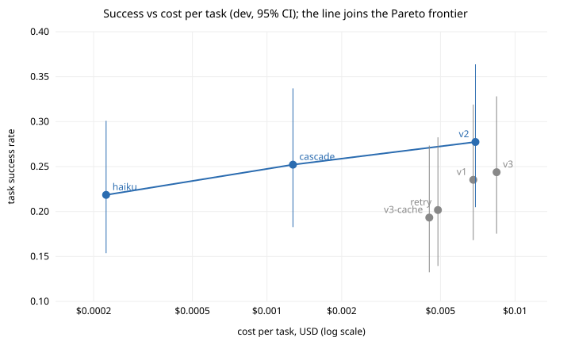

# 11. Improving with evidence: accuracy, latency, cost

**Goal:** run experiments that move MediaDoctor's metrics, prove which change moved them, and turn the result into
a decision someone else can trust.

**Estimated time:** 8 hours (lesson 2.5 h, lab 3.5 h, exercises and quiz 2 h)

By the end of this module you will be able to:

- choose what to fix first from a failure taxonomy, by the expected value of fixing each mode;
- design an experiment that changes one thing, with a metric and a decision rule written down before the run, a
  dev set to iterate on, and a held-out set you look at once;
- measure the three axes together: task success with a confidence interval, p50 and p95 latency with timeouts, and
  cost per task and **cost per successful task**;
- improve a prompt from error analysis, choose few-shot examples without leaking the eval set, and explain what
  automated prompt optimizers such as DSPy do;
- compare models (Sonnet against Haiku), routing and cascades, retries with a self-check, and prompt caching, each
  with its cost and latency;
- draw an accuracy against cost Pareto frontier and pick a point on it with uncertainty in view;
- know when to stop optimizing;
- report the result: an experiment log, a one-page decision memo, honest uncertainty, and the claims to avoid.

Artifacts: the **experiment log** (`uv run mediadoctor-lab11 log`), the **accuracy vs cost frontier**
(`uv run mediadoctor-lab11 pareto --svg runs/m11/pareto.svg`), a **decision memo**
(`uv run mediadoctor-lab11 memo`), the pre-registration (`config/experiments/preregistration.toml`), and the
[cost and latency cheat sheet](../../cheatsheets/cost-latency.md). Templates: the
[experiment log](../../eval-templates/experiment-log.md), the [decision memo](../../eval-templates/decision-memo.md),
and module 12's [eval report](../../eval-templates/eval-report.md).

## Intuition: pay for answers, not for calls

A cheap call that gives a wrong answer is not cheap. Someone acts on it, it fails, they come back, and either a
person fixes it or the agent runs again. The number that matters is what you spend to get **one task done right**:

```text
cost per successful task = (total cost of every call for every task) / (number of tasks that succeeded)
```

Media engineers already think this way about encoders. A faster preset that needs a second pass to hit the bitrate
target is not faster; the unit you care about is "seconds per file that meets spec", not "seconds per pass". In
this module a Haiku-only MediaDoctor costs about a twentieth of the Sonnet version per task. Whether that is a bargain
depends entirely on how many of its tasks are done right, so the denominator has to be measured well, by a grader
you have checked against labels (Step 3). Meanwhile one change that does not touch the model at all, prompt
caching, cuts the cost per task by almost half.

The other half of the intuition: **with LLMs, every change changes everything a little**. A longer prompt is more
accurate and slower and more expensive. A retry fixes some answers and doubles the time of the tasks it touches. So
change one thing at a time, measure all three axes every time, and decide by a rule you wrote down before you saw
the numbers.

## Step 1: choose what to fix, by expected value

Module 3 gave you a failure taxonomy with counts, severity, and a guess at how easy each mode is to fix. Turn that
into a ranking. For each mode:

```text
value   = rate x severity x P(the fix works)        # severity-weighted failures removed, per task
per day = value / effort in days
```

`uv run mediadoctor-lab11 ev` does this on module 3's 100 labelled traces, with P(fix) of 0.8, 0.6, and 0.3 for
easy, medium, and hard modes and an effort of 1, 3, and 8 days:

```text
  mode                      rate        95% CI sev    fix  value per day
  fabricated-evidence       0.03 [0.01, 0.08]   3   easy    7.2     7.2
  ignored-tool-output       0.00 [0.00, 0.04]   3 medium    0.0     0.0
  wrong-tool-args           0.00 [0.00, 0.04]   2   easy    0.0     0.0
  ...
  format-violation          0.00 [0.00, 0.04]   1   easy    0.0     0.0
```

On the regenerated module 3 traces the agent fails rarely: one mode, citing evidence that was never obtained, shows
up in 3 of 100 traces, and every other mode in none. Three things to take from it anyway. First, the ranking has
only one entry with any value, and it is severe and easy, so it goes first; the v3 prompt in this module aims at it
(and at answers that contradict the tool output, a mode an earlier round of error analysis ranked high and these
traces do not show). Second, a mode with zero occurrences is not a mode with zero rate: its interval reaches 4%,
so the ranking says "not seen in 100", not "absent". Third, look at the overlap: 3 of 100 is not separable from 0 of
100 at this size (the intervals [0.01, 0.08] and [0.00, 0.04] overlap). With more failures, the same table ranks
the big modes against the small ones but rarely the top few against each other; then do not argue for a week about
which comes first; take the cheap one, ship it, and re-run error analysis.

The P(fix) and effort numbers are guesses, and that is fine. Writing them down turns "I think we should fix X" into
an estimate a colleague can disagree with specifically. Hamel Husain and Shreya Shankar make the related point that
[not every failure mode deserves an automated evaluator](https://hamel.dev/blog/posts/evals-faq/should-i-build-automated-evaluators-for-every-failure-mode-i-find.html):
the same cost-benefit thinking applies to fixes.

## Step 2: design the experiment before you run it

An experiment that can be read honestly has five parts, and all five are written down before the first run.

1. **One change.** Each configuration in `config/experiments/variants.toml` names a parent and differs from it in
   one thing: the prompt, the model, caching, or a strategy. If you change the prompt and the model together and
   success rises, you do not know which did it, and the next person to touch either will undo it by accident. When
   two changes must ship together, run the ablation: each one alone, then both.
2. **A primary metric and a decision rule.** Here: task success (all four checks pass and the task finishes within
   15 seconds), with a superiority rule for changes meant to improve quality (the paired 95% CI for the difference
   must be above zero) and a **non-inferiority** rule for changes meant to save money (the CI's lower bound must be
   above minus 5 points, and cost per success must fall). Guardrail metrics sit alongside: p95 latency under
   12 seconds and cost per success under one cent.
3. **A dev set and a held-out set.** Iterate on dev (119 queries here). Keep the test split (28 queries) for one
   look, by the configuration you have chosen, just before release. Every time you look at a set and change
   something because of it, that set becomes a little more like training data. Module 8's `HoldoutGuard` enforces
   the rule: `confirm` refuses to read the held-out split without `--release`, and logs every look.
4. **A paired comparison.** Every configuration runs on the same queries, so compare them query by query. Paired
   tests are far more sensitive than comparing two independent rates, because most queries come out the same both
   ways; only the ones that changed carry information.
5. **A sample size you checked.** Module 6's `mdd_paired` tells you the smallest difference your dev set can
   reliably see. With 119 queries and 10% of them changing outcome, that is about 8 points. If you hope for a
   2-point gain, this experiment cannot show it; either get more data or do not run it.

Writing all of this down first is **pre-registration**, a practice borrowed from science, where it exists because
researchers who choose their analysis after seeing the data find effects that are not there (Gelman and Loken's
"[garden of forking paths](https://sites.stat.columbia.edu/gelman/research/unpublished/p_hacking.pdf)"). The lab's
`config/experiments/preregistration.toml` and `log.toml` are that record. Kohavi, Tang, and Xu's
[Trustworthy Online Controlled Experiments](https://experimentguide.com/) is the standard reference for the wider
discipline.

## Step 3: measure accuracy, latency, and cost together

`uv run mediadoctor-lab11 report` replays seven configurations on the 119 dev queries:

```text
variant   success         95% CI  p50 s  p95 s       95% CI t/o  cost/task cost/success                95% CI cache
v1          0.655 [0.566, 0.735]   7.94  15.84 [12.5, 30.4]   7   $0.00678     $0.01035 [$0.00913, $0.01203]    0%
v2          0.647 [0.558, 0.727]   7.77  12.05 [11.0, 22.8]   5   $0.00692     $0.01069 [$0.00945, $0.01232]    0%
v3          0.714 [0.627, 0.788]   7.42  14.80 [11.5, 21.7]   6   $0.00842     $0.01178 [$0.01064, $0.01323]    0%
v3-cache    0.639 [0.549, 0.719]   7.39  13.40 [10.3, 19.6]   4   $0.00451     $0.00706 [$0.00621, $0.00817]   72%
haiku       0.630 [0.541, 0.712]   2.34   3.85 [ 3.5,  6.8]   0   $0.00022     $0.00036 [$0.00031, $0.00041]   71%
cascade     0.689 [0.601, 0.765]   2.65  11.83 [10.4, 23.0]   4   $0.00127     $0.00185 [$0.00129, $0.00258]   71%
retry       0.647 [0.558, 0.727]   7.97  14.82 [12.6, 19.9]   5   $0.00489     $0.00755 [$0.00663, $0.00880]   57%
```

**Accuracy** is task success with a Wilson interval, as in module 6. Success here means the final answer passes
module 5's three code checks and a reference check of the diagnosis, and the whole task finished within the
timeout.

Before reading anything into the success column, check the grader against the reference labels. The same report
prints the failure modes the labels find in each configuration's final answers:

```text
Failure modes in the final answers (reference labels; dev):
  variant    premise  ignored  skipped   format
  v1               0        0        0        0
  v2               0        0        2        0
  v3               0        0        0        0
  v3-cache         0        0        3        0
  haiku            0        0        7        0
  cascade          0        0        0        0
  retry            0        0        3        0
```

The labels find a failure in 15 of the 833 dev answers; the grader fails 266. It catches all 15, and it also fails
251 of the 818 answers the labels call correct: a true negative rate of 69%. Read the disagreements before you
read the success column. 223 of the 251 are answers to questions that leave out the device or the file ("one of our
test phones", "one of our AV1 clips"). The agent rightly says it cannot check a device it was not named and offers
the usual cause as a hypothesis, so it does not run the tool the dataset expects (the `investigated` check) and
does not state the scenario's fact about that device or file (the `correct` check, a reference check of the
diagnosis per scenario). The labels do not call that a failure; the grader does. Most of the remaining 28 fail a
code check (`investigated` or `citations`) on an answer the labels accept. So the success rates above, 63% to 71%,
are "answered the question that was asked, with the evidence the dataset expected, in time", which is stricter than
the labels; by the labels, every configuration gets 94% to 100% of its answers right.

(An earlier version of the reference check matched exact phrases from the course's old hand-scripted answers, such
as "hardware AV1 decoder for Main", and failed most correct regenerated answers, which say the same thing in their
own words: every configuration scored 19% to 28%. That was a bug in the check, and it is fixed: the check now
accepts each scenario's key fact in any wording and still rejects answers that miss or contradict it.)

This is module 5's lesson, and it is the first thing to do with any grader: **validate it before you optimize
against it**. Count where it disagrees with the labels, read the disagreements, and decide whether they are the
grader's mistakes or a stricter definition you want. Here the definition question is real (should an answer that
asks for the missing device count as a success?), and it affects every configuration alike; the rest of this page
runs the method as registered on the grader's numbers and says where the labels see it differently.

**Latency** is the wall time of the whole task, read from the root span of the trace: every model call, every tool,
and every self-check. Report the median (p50, the typical user) and the 95th percentile (p95, the slow experience
one user in twenty has). Averages hide the tail, and the tail is what people remember. Note the intervals on p95:
with 119 tasks, the p95 rests on about six of them, so a difference of a second or two between configurations is
often noise. `evalkit.stats.percentile` interpolates between ranks the way NumPy does, so your numbers will match a
notebook.

A **timeout** turns latency into accuracy. A user who gives up after 15 seconds got no answer, so a task that ran
longer counts as a failure, however good the answer. v1 lost seven tasks this way, and v3 six; Haiku, at a
third of Sonnet's latency, lost none.

**Cost** is computed per call from the usage the API returns, with the prices in `config/models.toml`:

```text
cost = (uncached input x input price + output x output price
        + cache writes x cache-write price + cache reads x cache-read price) / 1,000,000
```

Cost per task averages that over tasks; cost per successful task divides the total by the number of successes, and
its interval comes from a bootstrap over tasks (resample the tasks, recompute the ratio). A configuration that is
cheap per call but needs more calls, or fails more often, shows up here.

## Step 4: the levers, and what each one costs

### Prompt changes, guided by error analysis

The first two experiments are prompt changes, each aimed at a mode the taxonomy ranked high. v2 is module 6's
prompt, which tells the agent to check the user's claims before relying on them. v3 adds three sentences aimed at the
two modes an earlier round of error analysis ranked highest (quote the exact tool value the cause depends on; when
tool output contradicts your expectation the output wins; cite only tools that returned a result) and two worked
examples.

```text
  v2        vs v1        -0.008 [-0.067, +0.050]  only parent  7, only v2  6  cost/success +3%
  v3        vs v2        +0.067 [+0.008, +0.126]  only parent  3, only v3 11  cost/success +10%
```

v2 does not clear the superiority bar: its interval straddles zero. v3's interval is above zero, but v3 breaks
both guardrails (p95 14.8 s against 12 s, and $0.0118 per success against one cent), and its parent v2 was not
kept, so the rule rejects it too. Read the discordant counts, not just the difference: v2 fixed 6 queries and broke
7, and 9 of those 13 changes are timeouts, a task finishing on one side of 15 s and not the other; v3 fixed 11 and
broke 3, mostly by calling the tool the question needed (5 queries) or citing it (2) where v2 had not. Then look at
the failure modes behind the numbers: the labels find no failure in v1's answers, 2 skipped investigations in
v2's, and none in v3's. That is the point of aiming a change at a mode: you can check that it hit the mode you
aimed at. Here the target modes (adopted premises, contradicted tool output) were not in v1's answers; on data
where they were, the same table would show whether v2 and v3 removed them.

v3 also costs 22% more per task than v2 (10% more per success, because it also succeeds more often), because the
examples add about 400 tokens to every call. Hold that thought.

**Few-shot examples** are the strongest prompt lever and the easiest to get wrong. Choose them from your failures (the
cases the model got wrong in error analysis), rewritten as correct answers, so they teach exactly what the model
lacks. v3's examples come from module 3's traces m3t059 (an answer that ignored ffprobe's start time) and m3t065 (a
citation of a log the agent never managed to read). Two rules:

- **Never take examples from the eval set.** An example that is also a test question measures memory, not skill.
  Less obviously, an example that is a near-copy of a test question does the same. Exercise 3 shows how the first
  draft of v3's first example was a near-copy of a training question and a held-out test question, and why a
  simple automatic check nearly lets it through.
- **Examples are part of the prompt.** They cost tokens on every call, and they can over-steer: a model shown two
  examples that both cite `[tool:ffprobe]` may start calling ffprobe when it is not needed. Re-run the whole suite,
  not only the cases the examples target.

**Automated prompt optimizers** such as [DSPy](https://dspy.ai/) ([Khattab et al., 2023](https://arxiv.org/abs/2310.03714))
treat the prompt (instructions and few-shot examples) as parameters and search for the version that scores best on
a metric you supply, using a training set of examples. Conceptually it is hill-climbing on your eval. That makes
them only as good as the metric and as safe as your split discipline: an optimizer will find every weakness in a
grader and will overfit a small dev set with enthusiasm. Hamel Husain and Shreya Shankar's advice is to
[write prompts by hand first](https://hamel.dev/blog/posts/evals-faq/should-i-stop-writing-prompts-manually-in-favor-of-automated-tools.html),
because writing forces you to state your requirements and an optimizer cannot discover failure modes it has no
metric for; once trusted evals exist, an optimizer can help with the last stretch. This course does not depend on
one; if you try one, give it the train split only and judge the result on dev and the held-out set like any other
variant.

### Model choice: Sonnet, Haiku, and cascades

Changing the model is the change people reach for first; Hamel and Shreya's FAQ suggests
[doing error analysis before switching models](https://hamel.dev/blog/posts/evals-faq/how-much-time-should-i-spend-on-model-selection.html),
because the failures are often in the prompt, the tools, or the data. When you do test a model, test it as a
non-inferiority question: is it good enough, for much less?

```text
  haiku     vs v3-cache  -0.008 [-0.067, +0.050]  only parent  7, only haiku  6  cost/success -95%
  cascade   vs v3-cache  +0.050 [+0.017, +0.092]  only parent  0, only cascade  6  cost/success -74%
```

The cascade passes the non-inferiority rule: its interval's lower bound is above minus 5 points, and it is far
cheaper per success. Haiku alone does not: its point estimate is within a point of v3-cache, but its interval
reaches minus 6.7 points, so the data cannot rule out a loss bigger than the margin. The labels point the same way:
7 of Haiku's 119 answers skipped the investigation (it answered without calling the tool the question needed),
against 3 for v3-cache. Whether a difference of that size is acceptable for your users is a product question; the
registered rule says the evidence is not strong enough to call it non-inferior.

A **cascade** runs the cheap model first and escalates to the expensive one only when something says the cheap
answer is bad (the idea behind [FrugalGPT](https://arxiv.org/abs/2305.05176), which chains models of increasing cost
behind a scorer). Its quality depends entirely on that "something". Here the router is module 5's three code checks:
format, citations, investigated. It escalated 27 of 119 tasks, including all 7 where Haiku skipped the
investigation (a skipped investigation fails the `investigated` or `citations` check), and the labels find no
failure in any of the cascade's final answers. The router works here because the one failure Haiku makes is one the
code checks can see. A failure that produces a well-formed, properly cited, wrong answer (adopting a false premise,
contradicting the tool output) would pass every code check and reach the user; this data has none, so it cannot
test that. A cascade is only as good as its router's recall on the failures that matter; measure it on labelled
data that contains them. Routing by query difficulty instead (easy questions to Haiku) needs a difficulty signal
you have tested the same way.

### Thinking and effort: the lever to try before a cheaper model

Every request in the course sets thinking and effort explicitly, per model, in `config/models.toml`
(`[generation.<model>]`): thinking off (Sonnet 5.5's `between_tools`, Haiku 5.5's `disabled`) and effort medium for
Sonnet, low for Haiku. Leaving them out is not neutral: both models then think by default, the thinking counts
toward `max_tokens` and is billed as output, and a 1024-token agent can end its turn at `stop_reason: "max_tokens"`
with no answer (the agent loops now mark that as an error on the trace, module 2).

That makes effort and thinking a lever in their own right, and for most teams the first one to measure, before a
cascade: the same model at lower effort often matches a stronger setting on routine work, keeps one prompt cache,
and needs no router. Treat it like any other variant: one change (say `v3-cache` with thinking adaptive and effort
high, with `max_tokens` raised to leave room for it), the same pre-registered rule, success with an interval, p95,
and cost per success, because thinking makes answers slower and longer. The course does not ship recordings for it,
since the recorded fixtures cannot say what thinking would change; it is the first experiment to run with a key
(module 12's [Make it your own](../12-capstone/extensions.md)).

### Retries and self-checks

The `retry` configuration adds a Haiku judge that reviews each answer against the tool output; on FAIL, the agent
gets the critique and one more try in the same conversation. This is a guardrail in the request path, in Hamel and
Shreya's terms, and they list the two questions to ask:
[latency and cost, and the balance of false positives and false negatives](https://hamel.dev/blog/posts/evals-faq/can-my-evaluators-also-be-used-to-automatically-fix-or-correct-outputs-in-production.html).
Measure both:

```text
Retry: the self-check sent 6/119 tasks back (0 of 3 defective answers caught, 6 false alarms on 116 good ones);
6 of the 6 retried tasks ended correct.
retry     vs v3-cache  +0.008 [-0.017, +0.042]  only parent  1, only retry  2  cost/success +7%  p95 +1.42 s
```

Read the judge's line against the labels first. It caught none of the 3 defective first answers and sent back 6
that were fine ("6 of the 6 retried tasks ended correct" only says they were still correct after the retry). Its
TPR is 0 of 3 and its false-alarm rate 6 of 116: on this data it is a cost with no benefit. Every task pays for the
judge call (about 0.5 s and a little money); the 6 retried tasks pay for a second agent turn (about 7 s each). The
paired difference by the grader is +0.8 points with an interval across zero, so `retry` fails its superiority rule,
and its p95 of 14.8 s breaks the 12 s guardrail as well. A self-check in the request path is a judge: measure its
TPR and TNR on labelled data, as in module 5, before you pay for it on every request.

Steps this small also expose a weakness in the rule itself. With fewer than about 10 discordant tasks the bootstrap
interval comes out too narrow, and module 6 says the exact McNemar test should decide; a registration that names
only the bootstrap can pass a step that McNemar would not. `config/experiments/preregistration.toml` carries an
amendment for that, written after an earlier round of these experiments in which the retry step rested on 5
discordant tasks (its comment still describes that round). The way it handles the mistake is the part to copy:

- **Do not change the rule after seeing the results.** Switching tests after seeing which one says "no" is the
  forking-paths problem the registration exists to prevent; the next study would switch back when that suited it.
- **Record an amendment, dated and marked as written after the results.** From the next study on, superiority needs
  the bootstrap interval above zero *and*, below 10 changed tasks, an exact McNemar p under 0.05.
- **Keep the registered decision, and say plainly what it rests on.** If a step passes only under the original
  rule, the memo and the eval report say so and recommend confirming it on more tasks. In this round no kept step
  is affected: the memo's "thinnest step" line reports that no kept change moved any task's outcome.

[Self-Refine](https://arxiv.org/abs/2303.17651) (Madaan et al.) studies the general pattern of a model critiquing
and revising its own output.

### Prompt caching

Every MediaDoctor call starts with the same thousand tokens: the tool definitions and the system prompt. Prompt
caching lets the API keep that prefix: the first request writes it to a cache (at 1.25 times the input price), and
later requests that start with the same bytes read it (at 0.05 times the input price for Sonnet 5.5, 0.1 times for
Haiku 5.5), for five minutes after the last use. You opt in by marking the end of the prefix:

```python
system = [{"type": "text", "text": PROMPTS["v3"], "cache_control": {"type": "ephemeral"}}]
```

The cached prefix is everything up to the marker, in the order tools, system, messages, so anything that varies
(the user's question, a timestamp) must come after it, and the prefix must reach the model's minimum length (512
tokens for Sonnet 5.5 and Haiku 5.5). Usage then reports `cache_creation_input_tokens` and
`cache_read_input_tokens` separately from `input_tokens`. The details are in
[Anthropic's prompt caching guide](https://platform.claude.com/docs/en/build-with-claude/prompt-caching) and the prices
in the [pricing page](https://platform.claude.com/docs/en/about-claude/pricing); `config/models.toml` holds the values
checked against both.

Caching does not change what the model sees, so it should not change the answers. That makes it the one
experiment whose rule is "no change": the graded answers must be identical.

```text
  v3-cache  vs v3        -0.076 [-0.143, -0.017]  only parent 12, only v3-cache  3  cost/success -40%
```

Here they are not: none of the 119 answers is word-for-word the same, and 23 grade differently, so the rule
rejects v3-cache ("graded answers identical: NO"). The cause is in how the recordings were made, not in caching:
v3 and v3-cache were generated in separate runs, so they are two independent samples of the same prompt, as two
runs on the real API at a temperature above zero would be. The rule did its job (it refused to call two different
sets of answers "unchanged"), and it shows what the registration left out: "no change" can only be checked against
a run that controls for sampling, at temperature 0 or with several runs of each configuration. By the labels the
two sets are about equally good (0 and 3 skipped investigations).

The cost side is what caching was for, and it holds: cost per task fell 46% ($0.00842 to $0.00451), and v3's extra
few-shot tokens are now almost free, because they sit in the cached prefix. (Cost per success fell only 40%,
because the success count fell too.) The 72% in the cache column is the share of input tokens read from
the cache.

Two caveats belong in any write-up. Caching pays only when requests arrive faster than the cache expires: exercise 4
shows a single call per cache lifetime costs 13% more than no caching. And for evals you run yourself, the
[Batch API](https://platform.claude.com/docs/en/build-with-claude/batch-processing) halves the price of every token
(the discounts stack) in exchange for results within 24 hours: right for a nightly suite, wrong for a user waiting.

### Latency: percentiles and timeouts

Latency adds up along the trace, so the trace tells you where it went. `uv run mediadoctor-lab11 latency retry`
splits each task's time into agent calls, self-check calls, and tools, and lists the tasks that slowed most;
exercise 2 uses it to explain why the retry configuration's p95 rose by 1.4 s while its p50 rose by 0.6 s (two
retried tasks climb into the slowest 5%; the four slowest were already slow without the retry). The general lessons:

- **Calls in sequence add up; the tail compounds.** A task with three calls in a row is slow if any one is slow.
  Dean and Barroso's [The Tail at Scale](https://research.google/pubs/the-tail-at-scale/) explains why
  tail latency, not median latency, dominates systems that combine many steps.
- **Output tokens are the slow part.** Each generated token costs time; input tokens are much cheaper, and cached
  input cheaper still. A shorter answer format is a latency lever. Anthropic's
  [reducing latency guide](https://platform.claude.com/docs/en/test-and-evaluate/strengthen-guardrails/reduce-latency)
  lists the others (smaller models, shorter prompts and outputs, streaming).
- **Set the timeout from the user, then count timeouts as failures.** The Google SRE book's chapter on
  [service level objectives](https://sre.google/sre-book/service-level-objectives/) explains why to set targets on
  percentiles rather than averages.

## Step 5: the frontier, and choosing a point on it

Plot success against cost per task: `uv run mediadoctor-lab11 pareto --svg runs/m11/pareto.svg`.



A configuration is on the **Pareto frontier** when no other is both cheaper and more accurate. Here that is Haiku,
the cascade, and v3. v1, v2, v3 with caching, and retry are dominated: the cascade beats each of them on both
axes. The frontier does not tell you which of its points to choose; that is a business question (what is a correct
answer worth to you, and what is a wrong one?). It does tell you which questions are worth asking.

Three traps when reading it:

- **The y-axis is only as good as the grader.** The whiskers overlap (63% to 71%, each about 17 points wide), and
  the labels say the configurations barely differ in quality, so the frontier's order on the y-axis is weak
  evidence. The x-axis, cost per task, is solid: it comes from token counts and prices.
- **Point estimates make the frontier look sharper than it is.** "The cheapest configuration within 2 points of the
  best" is v3 itself on point estimates, and no configuration can be shown to be within 2 points of it once you
  use the paired intervals (exercise 1). With this dev set, a 2-point tolerance is below what you can measure.
- **The x-axis is cost per task, not per success**, so that accuracy is not counted twice. Read cost per success off
  the report for the headline.

The lab applies the pre-registered rule mechanically: each change is kept only if it passed its own test (and every
guardrail) and its parent was kept, and the recommendation is the most accurate kept configuration. On this data
the chain stops at the start: v2 fails its rule, and so does v3-cache; v3's interval passes but it breaks both
guardrails and sits under the rejected v2. So the recommendation is to keep v1. The cascade passes its own rule
(Haiku alone does not), but it was registered as a change to v3-cache, which was rejected, so the rule cannot keep
it. That is the rule working as written, and it is worth seeing why it is written that way: a change tested against
a parent you did not keep has not been tested against what you would ship. If the cascade is worth pursuing (and on
cost it clearly is: 74% cheaper per success than v3-cache, 82% cheaper than v1, and no labelled failures), the
honest next step is a new registered experiment, cascade against v1; not an exception granted after seeing these
numbers.

Two more things the rule's output shows. First, even v1, the release, breaks both guardrails (p95 15.8 s against
12 s, and $0.0104 per success against one cent); only Haiku and the cascade meet both, so a guardrail is a real
constraint here, not a formality. Second, the numbers are measured on the dev queries every step was chosen on.
Sequential keep-or-drop decisions on the same 119 queries favour changes that happened to do well on them, so when a
chain does form, its total gain is optimistic: the held-out look is the estimate to lead with.

## Step 6: knowing when to stop

Stop optimizing, or at least stop this round, when one of these is true:

- **The next gain is below what you can measure.** By the labels, the configurations have 0 to 7 failures left in
  119 dev tasks; a fix that removes a third of retry's 3 is a gain of under a point, and seeing it reliably takes
  about 2,000 tasks (exercise 5). Without more data, you would be tuning to noise.
- **The remaining failures are not worth their cost.** By the grader, a perfect score would cut cost per success by
  35%; by the labels, almost every task already succeeds, and most of the grader's failures are the missing-detail
  answers and timeouts, so the saving you can buy with an agent fix is much smaller. Compare the saving you can
  trust with the engineering time and the added latency of the next idea.
- **The measurement is the bottleneck.** When the grader and the labels disagree on many answers, the next
  experiment is on the grader (or on the definition of success), not the agent. Settle it, re-validate, then come
  back.
- **The dev set is being used up.** Every round of "look at dev, change, re-run" fits the system a little to those
  119 queries. When the held-out result starts trailing dev, refresh the dev set from production (modules 4 and 9).
- **The failure taxonomy has changed.** After a big improvement, re-run error analysis. The top modes are now
  different, and the old ranking is stale.

The opposite mistake is stopping because a number looks good. A success rate with no interval, or measured on the
cases you tuned against, does not count.

## Step 7: communicating the result

Three documents, for three readers.

**The experiment log** is for your team and your future self. One entry per experiment: date, the one change, the
hypothesis and expected effect, the decision rule, the measured result with its interval, and the decision.
Write the first half before the run. The [template](../../eval-templates/experiment-log.md) has the fields;
`uv run mediadoctor-lab11 log` renders the lab's log from `config/experiments/log.toml` plus the measurements.
Failed experiments stay in the log: E1 to E3 and E6 are as useful as E4 and E5, because they stop the next person from
running them again, and E3's "graded answers identical: NO" records a gap in the registration that the next study
should close.

**The decision memo** is for the person who decides: one page, the decision requested in the first line, the
recommendation with three numbers (success, cost per success, p95), the options considered, how sure you are, what
you are not claiming, and next steps. `uv run mediadoctor-lab11 memo` drafts it from the numbers;
the [template](../../eval-templates/decision-memo.md) explains each section. Edit the draft: a generated memo is a
starting point, and you are the one who signs it.

**The eval report** (module 12's [template](../../eval-templates/eval-report.md)) is the reference behind the memo:
data, evaluators, full results, risks.

**Honest uncertainty** means every number that drives the decision comes with its interval and its n; the memo says
how small a difference the data can detect; the thinnest step in the chain is named ("this gain rests on five
tasks; read it as likely, not proven"); and the grader's agreement with the labels is stated, because every
success number depends on it.

**What not to say:**

- "66% accurate." Say "78 of 119 dev tasks passed our automated checks within 15 s; the checks also fail answers
  that ask for a missing device instead of guessing, and the reference labels find no failure in v1's 119 answers.
  Production questions differ."
- "Haiku is as good as Sonnet." Say "on this agent, prompt, and question mix, Haiku skipped the investigation in 7
  of 119 answers, against 0 to 3 for the Sonnet configurations."
- "No regression." Say "no difference we could detect; this test can see differences of about 8 points."
- "Caching halves cost." Say "at our traffic, where the cache stays warm, cost per task fell 46%."
- "Statistically significant" on its own. Say what the interval is, and what decision it supports.

## Worked example: "route easy questions to Haiku and cache the prompt"

Here is a proposal you will hear in some form on every LLM team: *send the easy questions to the small model and
cache the long system prompt, and the bill halves without hurting quality.* It sounds like one change. It is two,
and the lab tests them separately.

**Caching, by itself.** Take query m4q002 (a false premise about AV1 on the atlas-a1), whose run is not the first in
its batch, so the cache is warm. The first call of each run, from the traces:

```text
v3        input 1,092 uncached               output 79   $0.002974   (1,092 x $2 + 79 x $10) / 1M
v3-cache  input    75 uncached + 1,033 read  output 51   $0.000763   (75 x $2 + 1,033 x $0.10 + 51 x $10) / 1M
```

The 1,033-token prefix now costs about a hundredth of a cent per call instead of a fifth of a cent, and the output
tokens have become the largest part of the cost. (The output counts differ because the two runs are independent
samples; see Step 4.) Across the dev set, cost per task falls 46% and p95 does not get worse. The no-change rule
still rejects v3-cache, because its answers are a different sample from v3's; the cost half of the claim is true,
and "without changing any answer" is what this data cannot show.

**Routing, by itself.** The cascade sends every question to Haiku first and escalates to Sonnet when Haiku's answer
fails a code check. By the grader it is 5.0 points better than v3-cache (CI +1.7 to +9.2), comfortably inside the
5-point margin; by the labels none of its final answers has a failure, and it is 74% cheaper per success. The
router works here because Haiku's only failure in this data, skipping the investigation, is one the code checks
see. The proposal's "easy questions to Haiku" also hides an assumption: this router does not route by difficulty
at all, it routes by a check on the answer, and that is why it can be tested.

**What goes in the memo.** Not "we halved the bill": "caching cut cost per task by 46%; a Haiku-first cascade passed
its non-inferiority test at 74% lower cost per success, with no failures in the reference labels; neither can be
adopted under the registered rule, because both were tested against a parent that failed its own rule. We recommend
keeping v1 and registering cascade against v1 as the next experiment." The held-out split stays untouched: the recommendation is
the release itself, so there is nothing to confirm, and the one look is worth more to the next study than to a
configuration chosen after the fact.

```text
$ uv run mediadoctor-lab11 confirm cascade
refused: 'confirm cascade' asked for 28 held-out case(s), e.g. m4q008; only a release evaluation may read the held-out split
(add --release for the one pre-release look; it is logged)
```

That is a less exciting memo than "5 points better and a quarter of the price", and a more useful one: it says what
is known (the cost), what is not (whether the cascade holds up against the release itself), and what to do to find
out.

## Checklist

- [ ] The fix was chosen by expected value from the failure taxonomy, with the guesses written down.
- [ ] Each configuration differs from its parent in one thing; combined changes have an ablation.
- [ ] The primary metric, guardrails, margin, and decision rule were written before the first run.
- [ ] The grader behind the primary metric was checked against reference labels (TPR and TNR) before any decision.
- [ ] Experiments run on dev; the held-out split is read once, by the chosen configuration, and the look is logged.
- [ ] Comparisons are paired on the same queries; the discordant counts are reported.
- [ ] The minimum detectable difference was checked before the run.
- [ ] Every report has success with a CI, p50 and p95 latency, timeouts counted as failures, cost per task, and cost
      per successful task.
- [ ] Few-shot examples come from failures outside the eval set and are checked for near-duplicates.
- [ ] Caching was verified to change no answer; its savings are stated for the traffic that keeps it warm.
- [ ] Cascades and retries are reported with their router or judge accuracy and their latency cost.
- [ ] The experiment log keeps failed experiments; the decision memo fits on one page and avoids the claims above.

## Summary

Cost per successful task is the number to optimize, measured alongside task success with an interval and latency at
p50 and p95. Choose fixes by expected value from the failure taxonomy, change one thing at a time, and decide by a
rule written down first, on a dev set, with one held-out look before release. On MediaDoctor's regenerated data the
agent rarely fails: the reference labels find a failure in 15 of 833 dev answers, so the configurations barely
differ in quality. The lab's grader catches all 15 and also fails 251 answers the labels accept, most of them
answers that rightly ask for a device or file the question left out; check a grader against labels like this
before you trust its success rates (63% to 71% here). Run as registered, the rule keeps nothing and recommends
staying on v1: v2 and v3-cache fail their rules, v3 breaks the guardrails, and the cascade, which passes its own
rule, sits under a rejected parent. The cost results hold regardless: prompt caching cut cost per task by 46%, and
a Haiku-first cascade with code-check escalation was 74% cheaper per success than Sonnet with caching and had no
labelled failures, because the code checks catch the one failure Haiku makes here. The self-check judge caught
none of the 3 defective answers and cost 0.5 s on every task. Stop when the next gain is below what your data can
measure, worth less than it costs, or hidden behind a measurement you cannot trust.

Next: [Module 12](../12-capstone/index.md) puts the whole course together in a capstone eval report.

Continue with the [lab](lab.md), the [exercises](exercises.md), and the [quiz](quiz.md).
